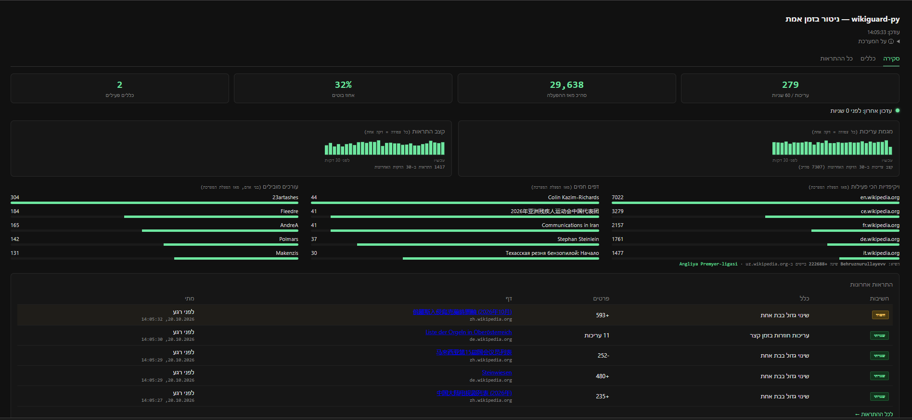
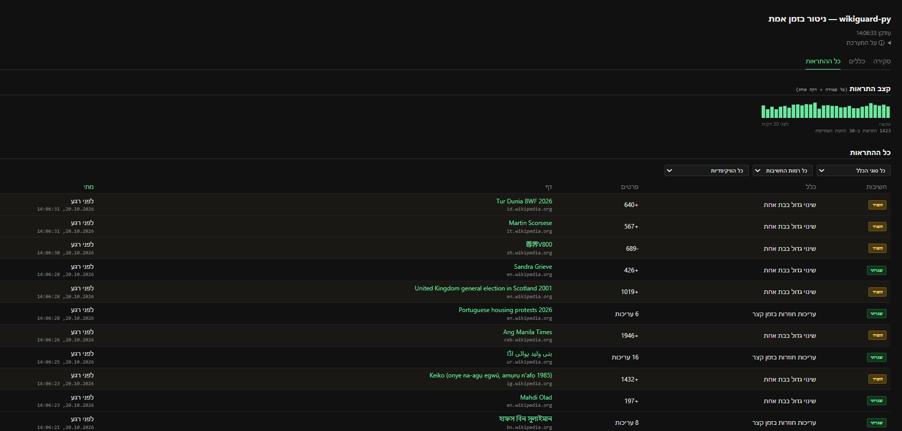
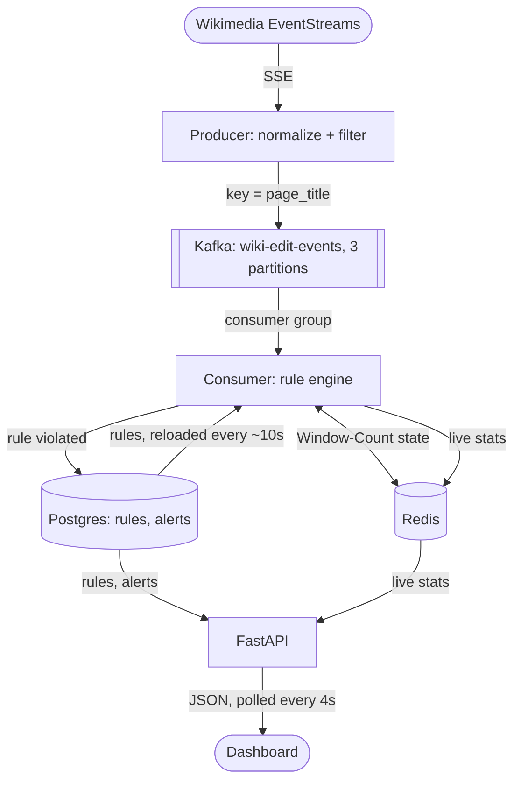
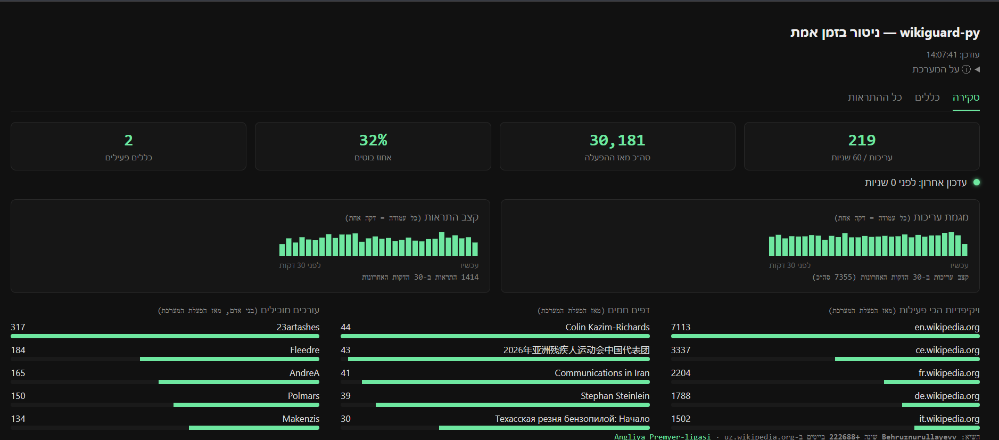

# wikiguard-py

[](https://github.com/nemiys/wikiguard-py/actions/workflows/ci.yml)

A real-time Wikipedia edit-integrity monitor — watches the live global stream
of Wikipedia edits, flags suspicious patterns (vandalism, edit wars), and
exposes both the alerts and the underlying stream's live activity through a
dashboard.

The pipeline is built around **Kafka**: reading the stream and analyzing it
are separate processes, the analysis scales horizontally, and partitioning
keeps each page's edits in order. Every significant decision (Kafka vs.
Redis Streams, the partition key, idempotent event IDs, ORM boundaries, ...)
is recorded as it was made — see [Design decisions](#design-decisions).



## Quick start

Requires Docker and Docker Compose. Nothing else — no local Python
environment needed to run it.

```bash
docker compose up -d
```

This builds and starts the full pipeline: Postgres, Redis, Kafka, the
producer (reads Wikipedia's live edit stream), the consumer (evaluates
rules), and the API + dashboard. Every service restarts on its own if it
crashes (`restart: unless-stopped`).

Open **http://localhost:8000/** — the dashboard starts updating within a few
seconds as real Wikipedia edits flow through.

```bash
docker compose down          # stop everything
docker compose logs -f api   # follow one service's logs
```

## What it does

Wikipedia broadcasts every edit across every language edition in real time
(Wikimedia EventStreams). This project:

1. Reads that stream and keeps only genuine Wikipedia content edits (filters
   out sister projects like Wikidata/Wiktionary, and non-content namespaces).
2. Runs each edit through configurable rules:
   - **Threshold** — a single edit changes more than *N* bytes at once.
   - **Window-Count** — a page is edited more than *N* times within a time
     window (edit-war detection).
3. Records every rule violation as a durable alert, and records live
   stream statistics (throughput, bot-vs-human ratio, most active wikis/
   pages/editors, the biggest single edit seen) — this is what lets the
   dashboard prove the system is alive even during the long stretches
   when nothing is actually suspicious.
4. Serves both through a dashboard: an at-a-glance overview, full alert
   history with server-side sorting/filtering/pagination, and live rule
   editing.



## Architecture



Arrows show the direction data flows.

Kafka's role is deliberate, not incidental: it decouples the producer from
the consumer entirely (one can restart without the other losing data),
lets the consumer scale horizontally (`docker compose up --scale consumer=3`
triggers a real consumer-group rebalance), and gives per-page ordering
guarantees via partition routing — which is what makes the Window-Count
rule correct under concurrent load.

## Tech stack

| Layer | Technology | Why |
|---|---|---|
| Streaming | Kafka (`aiokafka`) | Decouples reading the stream from analyzing it; partitioning and consumer groups for horizontal scale |
| Sliding-window state | Redis (`redis.asyncio`) | Transient per-rule state (Window-Count) and live stream stats — never the durable record |
| Persistence | Postgres + SQLAlchemy 2.0 (async) | Durable business state: rule definitions, fired alerts |
| API | FastAPI | Async REST API, rules CRUD + alert history + live stats |
| Validation | Pydantic v2 | Runtime validation of untrusted external data (the raw Wikimedia stream) |
| Dashboard | Plain HTML/CSS/JS | No framework, no build step — served directly by FastAPI |
| Tooling | `uv`, `ruff`, `mypy`, `pytest`, `node:test`, GitHub Actions | Dependencies, linting, type checking, Python and dashboard tests, CI on every push |

## Features

- **Live stream statistics**, independent of alerts — throughput, bot/human
  ratio, most active wikis/pages/editors, a 30-minute activity trend.
- **Full alert history** — server-side sorting (click a column header),
  filtering (severity, rule type, specific wiki), and pagination — added
  after measuring the first, unpaginated version at 3.1 MB per request.
- **Live rule editing** — thresholds are adjustable from the dashboard
  itself and take effect within ~10 seconds, no restart.
- **Horizontal scale demo** — `docker compose up --scale consumer=3` and
  watch a real Kafka consumer-group rebalance in the logs.



## Project structure

```
src/wikiguard_py/
  domain/        pure business logic (event model, rule evaluators) — no I/O
  producer/       reads the live stream, normalizes, publishes to Kafka
  consumer/       loads rules, evaluates events, records alerts + stats
  persistence/    SQLAlchemy models + Pydantic schemas (deliberately separate)
  api/            FastAPI routers
  static/         the dashboard (single file)
tests/            pytest, mirrors the src/ layout
docs/adr/         architecture decision records, one per significant choice
```

## Running tests

```bash
uv sync
uv run pytest
uv run ruff check src tests
uv run mypy src
node --test tests_js/*.test.js   # dashboard.js's pure display-logic functions
```

## Development without Docker

Each service can also run directly on the host (useful for fast iteration):

```bash
docker compose up -d postgres redis kafka   # infra only
uv run uvicorn wikiguard_py.main:app --reload --port 8000
uv run python -m wikiguard_py.consumer.main
uv run python -m wikiguard_py.producer.main
```

## Design decisions

Each significant choice is recorded in [`docs/adr/`](docs/adr/) as it was
made: what was decided, what else was considered, and why. One record per
decision that would be expensive to reverse.

| ADR | Decision | Rejected alternatives |
|---|---|---|
| [0001](docs/adr/0001-kafka-over-redis-streams.md) | Kafka between reading the stream and analyzing it | Redis Streams; an in-process `asyncio.Queue` |
| [0002](docs/adr/0002-partition-key-page-title.md) | Partition key is the page title, so each page's edits stay in order on one consumer | `event_id`; the editing user |
| [0003](docs/adr/0003-deterministic-event-id.md) | Event ID is `{wiki}:{revision_id}`, the same on every retry | A random UUID; `revision_id` alone |
| [0004](docs/adr/0004-sqlalchemy-not-sqlmodel.md) | SQLAlchemy models and separate Pydantic schemas | SQLModel, one class for both |
| [0005](docs/adr/0005-evaluator-as-object.md) | Each rule type is a class with a shared `evaluate()` method | A value and a function; one function with a branch per rule type |
| [0006](docs/adr/0006-persistence-schema-per-rule-type.md) | One table per rule type; alerts point to rules without a foreign key | One shared table with nullable columns; a shared registry table |

## License

[MIT](LICENSE)
