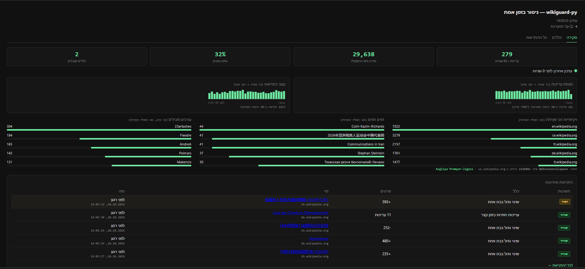
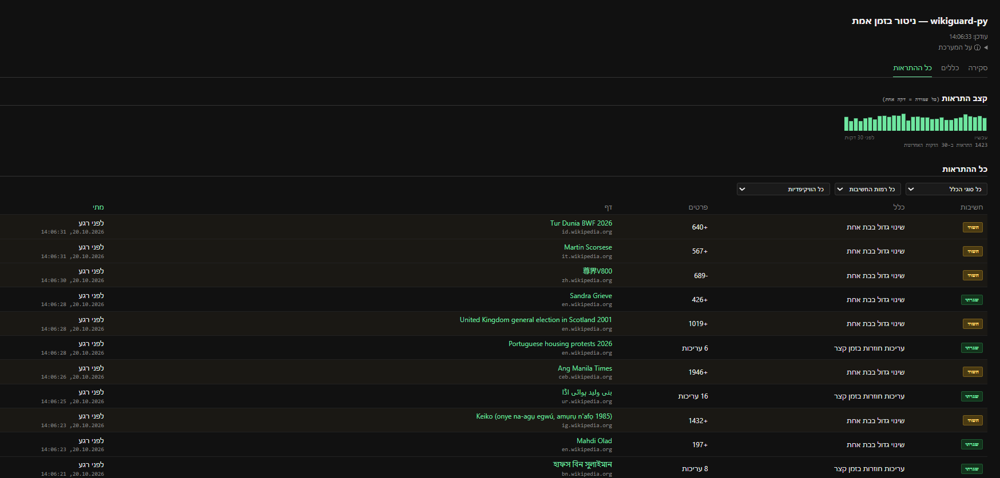
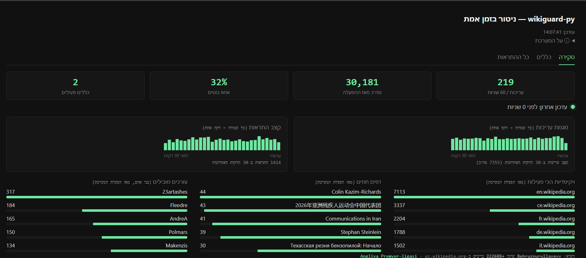

# wikiguard-py

[](https://github.com/nemiys/wikiguard-py/actions/workflows/ci.yml)

A real-time Wikipedia edit-integrity monitor — watches the live global stream
of Wikipedia edits, flags suspicious patterns (vandalism, edit wars), and
exposes both the alerts and the underlying stream's live activity through a
dashboard.

Built from first principles as a learning project centered on **Kafka as a
high-throughput streaming pipeline** — a deliberate choice to practice
message-queue architecture, not a side effect of the tech already being in
some other stack. Every architectural decision (Kafka vs. Redis Streams,
partition-key choice, idempotent event IDs, ORM boundaries, ...) is recorded
as it was made — see [`docs/adr/`](docs/adr/).



## Quick start

Requires Docker and Docker Compose. Nothing else — no local Python
environment needed to run it.

```bash
docker compose up -d
```

This builds and starts the full pipeline: Postgres, Redis, Kafka, the
producer (reads Wikipedia's live edit stream), the consumer (evaluates
rules), and the API + dashboard. Every service restarts on its own if it
crashes (`restart: unless-stopped`).

Open **http://localhost:8000/** — the dashboard starts updating within a few
seconds as real Wikipedia edits flow through.

```bash
docker compose down          # stop everything
docker compose logs -f api   # follow one service's logs
```

## What it does

Wikipedia broadcasts every edit across every language edition in real time
(Wikimedia EventStreams). This project:

1. Reads that stream and keeps only genuine Wikipedia content edits (filters
   out sister projects like Wikidata/Wiktionary, and non-content namespaces).
2. Runs each edit through configurable rules:
   - **Threshold** — a single edit changes more than *N* bytes at once.
   - **Window-Count** — a page is edited more than *N* times within a time
     window (edit-war detection).
3. Records every rule violation as a durable alert, and records live
   stream statistics (throughput, bot-vs-human ratio, most active wikis/
   pages/editors, the biggest single edit seen) — this is what lets the
   dashboard prove the system is alive even during the long stretches
   when nothing is actually suspicious.
4. Serves both through a dashboard: an at-a-glance overview, full alert
   history with server-side sorting/filtering/pagination, and live rule
   editing.



## Architecture

```
Wikimedia EventStreams (public, live)
        │  SSE
        ▼
[Producer] ── normalizes + filters (structural only, no business logic)
        │
        ▼
Kafka topic "wiki-edit-events" (3 partitions, keyed by page_title —
guarantees per-page edit ordering, required for Window-Count)
        │
        ▼
[Consumer] ── loads rules from Postgres, re-checks every ~10s
        ├─ Threshold rule: pure in-memory check
        └─ Window-Count rule: Redis sorted set (sliding window)
        │
        ├─▶ rule violated → Postgres (fired_alerts) — durable record
        └─▶ every event  → Redis (stream stats) — ephemeral, for live display
        ▼
[FastAPI] ── Postgres for alerts/rules (source of truth),
             Redis directly for live stats (explicitly not durable —
             see docs/adr and the API's own docstrings)
        ▼
[Dashboard] ── single HTML+JS page, no build step/framework, polls every 4s
```

Kafka's role is deliberate, not incidental: it decouples the producer from
the consumer entirely (one can restart without the other losing data),
lets the consumer scale horizontally (`docker compose up --scale consumer=3`
triggers a real consumer-group rebalance), and gives per-page ordering
guarantees via partition routing — which is what makes the Window-Count
rule correct under concurrent load.

## Tech stack

| Layer | Technology | Why |
|---|---|---|
| Streaming | Kafka (`aiokafka`) | The core learning subject — producer/consumer decoupling, partitioning, consumer groups |
| Sliding-window state | Redis (`redis.asyncio`) | Transient per-rule state (Window-Count) and live stream stats — never the durable record |
| Persistence | Postgres + SQLAlchemy 2.0 (async) | Durable business state: rule definitions, fired alerts |
| API | FastAPI | Async REST API, rules CRUD + alert history + live stats |
| Validation | Pydantic v2 | Runtime validation of untrusted external data (the raw Wikimedia stream) |
| Dashboard | Plain HTML/CSS/JS | No framework, no build step — served directly by FastAPI |
| Tooling | `uv`, `ruff`, `pytest` | Dependency management, linting, testing |

## Features

- **Live stream statistics**, independent of alerts — throughput, bot/human
  ratio, most active wikis/pages/editors, a 30-minute activity trend.
- **Full alert history** — server-side sorting (click a column header),
  filtering (severity, rule type, specific wiki), and pagination. Built
  after discovering the naive version returned the entire table unbounded
  (3.1MB per request) — see `docs/adr`/commit history for the fix.
- **Live rule editing** — thresholds are adjustable from the dashboard
  itself and take effect within ~10 seconds, no restart.
- **Horizontal scale demo** — `docker compose up --scale consumer=3` and
  watch a real Kafka consumer-group rebalance in the logs.



## Project structure

```
src/wikiguard_py/
  domain/        pure business logic (event model, rule evaluators) — no I/O
  producer/       reads the live stream, normalizes, publishes to Kafka
  consumer/       loads rules, evaluates events, records alerts + stats
  persistence/    SQLAlchemy models + Pydantic schemas (deliberately separate)
  api/            FastAPI routers
  static/         the dashboard (single file)
tests/            pytest, mirrors the src/ layout
docs/adr/         architecture decision records, one per significant choice
```

## Running tests

```bash
uv sync
uv run pytest
uv run ruff check src tests
```

## Development without Docker

Each service can also run directly on the host (useful for fast iteration):

```bash
docker compose up -d postgres redis kafka   # infra only
uv run uvicorn wikiguard_py.main:app --reload --port 8000
uv run python -m wikiguard_py.consumer.main
uv run python -m wikiguard_py.producer.main
```

## Design decisions

Significant architectural choices are recorded as they were made in
[`docs/adr/`](docs/adr/) — what was decided, what alternatives were
considered, and why. Not a changelog: each ADR documents one decision that
would be hard or expensive to reverse later.
